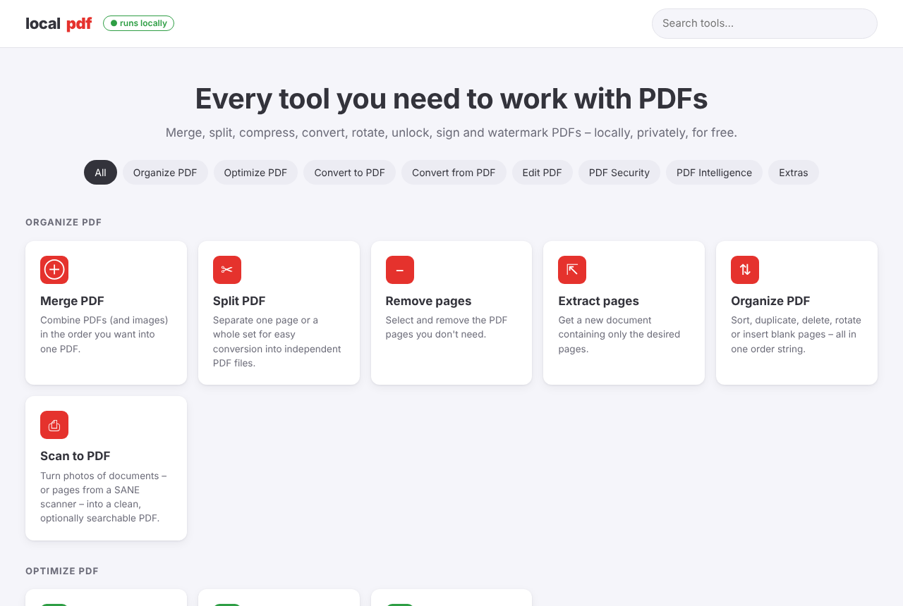
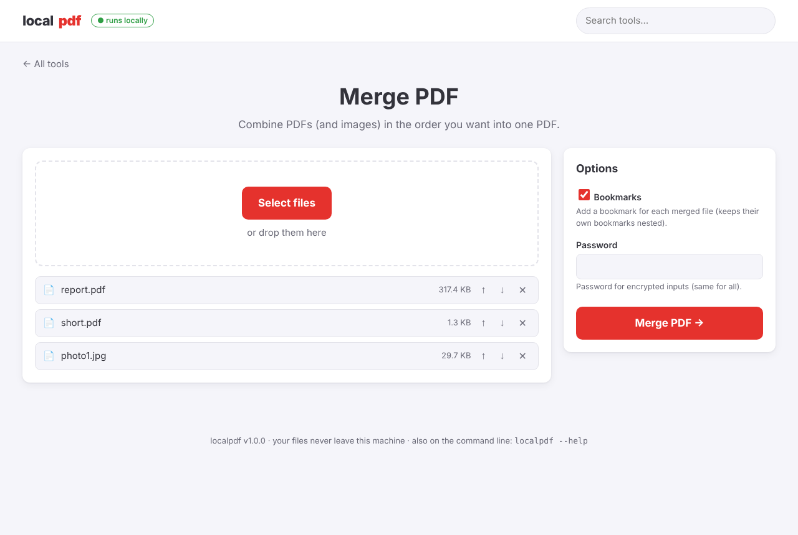

# localpdf

**Every [iLovePDF](https://www.ilovepdf.com/) tool, plus 21 more, running on your own Linux machine.**
It has a command line and a private web interface. Your files are processed on your computer and are never uploaded.



```bash
localpdf merge a.pdf b.pdf scan.jpg -o all.pdf
localpdf html-to-pdf ./my-site/index.html          # local HTML files, not only URLs!
localpdf compress *.pdf --level extreme            # batch mode for any single-file tool
localpdf web --open                                # iLovePDF-style UI on http://127.0.0.1:8765
```

> localpdf is an independent open-source project. It is not affiliated with or endorsed by iLovePDF.

---

## Tool parity with iLovePDF

| iLovePDF tool | localpdf command | Engine |
|---|---|---|
| Merge PDF | `merge` | PyMuPDF (also merges images; adds a bookmark per file) |
| Split PDF | `split` | by page, ranges, every N pages, **max size**, **bookmarks** |
| Remove pages | `remove-pages` | PyMuPDF |
| Extract pages | `extract-pages` | PyMuPDF |
| Organize PDF | `organize` | reorder, duplicate, rotate and insert blank pages in one string |
| Scan to PDF | `scan-to-pdf` | photos → straightened, cropped, cleaned PDF, **or a real scanner via SANE**, optional OCR |
| Compress PDF | `compress` | Ghostscript + PyMuPDF image recompression (keeps the smallest result) |
| Repair PDF | `repair` | qpdf (pikepdf) → MuPDF → Ghostscript |
| OCR PDF | `ocr` | OCRmyPDF or Tesseract (invisible text layer over the untouched scan) |
| JPG to PDF | `jpg-to-pdf` | JPG, PNG, WEBP, TIFF (multi-page), GIF, HEIC* |
| Word to PDF | `word-to-pdf` | LibreOffice (doc, docx, odt, rtf…) |
| PowerPoint to PDF | `powerpoint-to-pdf` | LibreOffice (ppt, pptx, odp…) |
| Excel to PDF | `excel-to-pdf` | LibreOffice (xls, xlsx, ods, csv…); all columns fit the page width, or one page per sheet |
| HTML to PDF | `html-to-pdf` | headless Chromium → WeasyPrint → wkhtmltopdf → LibreOffice → MuPDF |
| PDF to JPG | `pdf-to-jpg` | renders pages (jpg/png/webp/tiff) **or extracts embedded images** |
| PDF to Word | `pdf-to-word` | pdf2docx (or LibreOffice), output docx/odt/rtf/doc |
| PDF to PowerPoint | `pdf-to-powerpoint` | exact-looking image slides (text kept in notes), or editable via LibreOffice |
| PDF to Excel | `pdf-to-excel` | word-based table engine (handles borderless, rotated and fake-bold tables); numbers, %, currencies become real numeric cells |
| PDF to PDF/A | `pdf-to-pdfa` | OCRmyPDF or Ghostscript (PDF/A-1b, 2b, 3b) |
| Rotate PDF | `rotate` | per page or all pages; several files at once |
| Add page numbers | `page-numbers` | 9 positions, templates such as `Page {n} of {total}`, facing pages |
| Add watermark | `watermark` | text or image, opacity, any angle, tiled, over or under the content |
| Crop PDF | `crop` | margins, an exact box, or **automatic whitespace trimming** |
| Edit PDF | `edit` | text, text boxes, images, shapes, highlights, notes, links, **find & replace** |
| Unlock PDF | `unlock` | removes passwords and restrictions |
| Protect PDF | `protect` | AES-256, fine-grained permissions |
| Sign PDF | `sign` | typed, image or **hand-drawn** (web UI) signature, initials and date, **plus real X.509 digital signatures** |
| Redact PDF | `redact` | true redaction (content removed): words, regex, presets (email, phone, IBAN, card…), areas |
| Compare PDF | `compare` | side-by-side with highlighted text changes and pixel-level differences |
| AI Summarizer | `summarize` | offline extractive summarizer, or any local LLM via [Ollama](https://ollama.com) |
| Translate PDF | `translate` | keeps the layout; offline Argos Translate or Ollama |

## Bonus tools ★ (not on iLovePDF)

| Command | What it does |
|---|---|
| `html-to-pdf` **with local files** | `.html` files, whole folders (`index.html` plus CSS, images and JS), zipped sites, single long page mode, screen/print CSS, ad blocking |
| `html-to-pdf` **designed pages** | HTML laid out as sheets of paper (CVs, invoices, reports in a 210×297 mm box) is detected and printed **exactly as the browser shows it**, one PDF page per sheet, with links kept |
| `markdown-to-pdf` | Markdown with GitHub-like styling, tables and code highlighting |
| `text-to-pdf` | text, logs and source code → paginated monospace PDF, optional line numbers |
| `office-to-pdf` | anything LibreOffice opens (ODG, VSD, PUB, EPUB, WPS…) |
| `pdf-to-text` / `pdf-to-html` / `pdf-to-markdown` | extract the content in a reusable format |
| `ask` | chat with a PDF: answers with page references (local LLM) |
| `info` | pages, sizes, fonts, images, encryption, forms, scanned-document detection (`--json`) |
| `metadata` | edit title/author/… or wipe all metadata |
| `flatten` | burn forms and annotations into the page, or rasterize everything |
| `grayscale` | convert to gray to save ink |
| `fill-form` | list form fields or fill them from JSON |
| `attachments` | embed files in a PDF or extract its attachments |
| `bookmarks` | export or replace the outline, or **auto-generate it from headings** |
| `reverse`, `interleave` | fix back-to-front scans and single-sided duplex scans |
| `n-up`, `booklet` | 2/4/6/8/9/16 pages per sheet; saddle-stitch booklet imposition |
| `resize` | fit every page to A4/Letter/… |
| `remove-blank`, `insert-blank` | drop empty pages, or add note-taking pages |

Run `localpdf list` to see every tool, and `localpdf <tool> -h` for its options.

## Examples & evaluation

[`examples/`](examples) contains every conversion run on real-world public-domain PDFs and on realistic generated
Word/Excel/PowerPoint/HTML/image files. Each one comes with its output, a before/after preview, automatic quality
metrics and a graded evaluation. See **[examples/README.md](examples/README.md)**.

## Installation

### One command (Debian/Ubuntu, Fedora, Arch, openSUSE)

```bash
git clone https://github.com/EEmeka33/localpdf.git
```

```bash
cd localpdf && ./install.sh --desktop
```

This installs LibreOffice, Ghostscript, Tesseract, OCRmyPDF, qpdf and SANE. It also creates an isolated Python environment in `~/.local/share/localpdf`, downloads headless Chromium, and puts `localpdf` in `~/.local/bin`. `--desktop` adds a launcher to your application menu. Other options are `--no-system` (no sudo; Python part only) and `--ocr-langs "fra deu spa"`.

### With pip / pipx

```bash
pipx install "localpdf[all] @ git+https://github.com/EEmeka33/localpdf.git"
```

```bash
playwright install chromium
```

### Docker (all dependencies included)

```bash
docker build -t localpdf .
```

```bash
docker run --rm -p 127.0.0.1:8765:8765 localpdf
```

```bash
docker run --rm -v "$PWD:/work" localpdf compress /work/file.pdf
```

Run `localpdf doctor` at any time to see which optional engines are installed and how to add the missing ones. Each tool falls back to another engine when one is missing.

## Usage

```bash
# Organize
localpdf merge intro.pdf chapter*.pdf cover.png -o book.pdf
localpdf split book.pdf --mode ranges --ranges "1-3;4-10;11-"
localpdf split book.pdf --mode size --max-size 9          # parts under 9 MB (email limits)
localpdf organize doc.pdf --order "3,1-2,blank,4:90,5-"   # reorder + blank page + rotate page 4
localpdf scan-to-pdf IMG_*.jpg --mode bw --ocr            # phone photos → clean searchable PDF
localpdf scan-to-pdf --scanner --pages-to-scan 3 -o scan.pdf

# Convert
localpdf html-to-pdf report.html                          # CSS, images and JS from the folder work
localpdf html-to-pdf cv.html                              # an A4 "sheet" in HTML → that sheet, as on screen
localpdf html-to-pdf cv.html --sheet-fit grow             # keep 1:1 size if the content overflows A4
localpdf html-to-pdf cv.html --sheets off                 # ignore the sheet and print the document normally
localpdf html-to-pdf ./site/ --media screen --paper single
localpdf html-to-pdf https://example.com --block-ads
localpdf word-to-pdf *.docx
localpdf pdf-to-word contract.pdf
localpdf pdf-to-excel statement.pdf --layout single-sheet
localpdf excel-to-pdf wide-sheet.xlsx --fit page          # every sheet on one page
localpdf pdf-to-jpg slides.pdf --dpi 300 --format png
localpdf pdf-to-jpg brochure.pdf --mode extract           # pull out the original images

# Edit
localpdf page-numbers thesis.pdf --pages 3- --format "Page {n} of {total}" --position bottom-right
localpdf watermark draft.pdf --text DRAFT --position tile --opacity 0.15
localpdf watermark doc.pdf --image logo.png --position top-right --rotation 0 --scale 0.15
localpdf crop slides.pdf --auto
localpdf edit form.pdf --find "2023" --replace "2024"
localpdf edit doc.pdf --ops edits.json                   # see `localpdf edit -h` for the JSON operations

# Security
localpdf protect payroll.pdf --password 's3cret' --allow print
localpdf unlock locked.pdf --password 's3cret'
localpdf sign contract.pdf --name "Jane Doe" --initials JD
localpdf sign contract.pdf --image my-signature.jpg --cert me.p12 --cert-password … --reason Approved
localpdf redact cv.pdf --presets email,phone --text "Secret Corp" --label REDACTED
localpdf compare v1.pdf v2.pdf -o changes.pdf

# Intelligence (local)
localpdf summarize paper.pdf                              # offline, no model needed
localpdf summarize paper.pdf --engine ollama --model llama3.2 --language French
localpdf translate manual.pdf --to fr                     # layout preserved
localpdf ask manual.pdf --question "What is the warranty period?"
```

**Page selections** can be written as `1,3-5`, `7-` (to the end), `-4`, `9-1` (reversed), `odd`, `even`, `last`, or `r2` (second-to-last page).

**Batch mode**: give a single-file tool several files and it processes each one. `-o` then names an output folder.

## Web interface

```bash
localpdf web --open
```

This opens a page modelled on iLovePDF at `http://127.0.0.1:8765`. It has every tool, search, categories, drag & drop, file reordering for merging and a signature drawing pad. Results download straight away, and multi-file results come as a ZIP. The server listens on localhost only. Use `--host 0.0.0.0` to share it on your LAN; it prints a warning when you do. Uploads are limited by `LOCALPDF_MAX_UPLOAD_MB` (default 2048).



## Local AI

`summarize` works fully offline out of the box. For LLM-quality summaries, translation and `ask`, install [Ollama](https://ollama.com) and pull a model:

```bash
ollama pull llama3.2
```

```bash
localpdf summarize report.pdf --engine ollama
```

Use the `LOCALPDF_MODEL` and `OLLAMA_HOST` environment variables to change the defaults. For offline neural translation without Ollama, run `pip install argostranslate`. The language model is downloaded once, the first time you use it.

### HTML pages designed as paper (CVs, invoices…)

Many HTML documents draw an A4 "sheet" on screen, often with `width:210mm; min-height:297mm`. Printing such
a page the usual way breaks it. The browser lays the document out again at the paper width, the 210 mm sheet doesn't
fit inside A4 minus margins, and responsive CSS (`@media (max-width: …)`) switches to the mobile layout. You end up
with a one-column, two-page PDF that looks nothing like the screen.

`html-to-pdf` detects these sheets (`--sheets auto`, the default). It renders the page exactly as the browser
displays it, at full width, and turns each sheet into one PDF page of the exact paper size. Text stays selectable
and links stay clickable. If the content is taller than the sheet's paper (it overflows A4 on screen too),
`--sheet-fit shrink` (default) scales it onto one page and tells you by how much; `--sheet-fit grow` keeps it
1:1 on a taller page. Use `--sheets ".my-page"` to pick the sheets yourself, or `--sheets off` to print the document normally.

## Configuration

| Variable | Purpose |
|---|---|
| `LOCALPDF_CHROMIUM` | path to a Chrome/Chromium binary for `html-to-pdf` (if you don't use `playwright install`) |
| `LOCALPDF_MODEL` | default Ollama model (default `llama3.2`) |
| `OLLAMA_HOST` | Ollama address (default `http://127.0.0.1:11434`) |
| `LOCALPDF_MAX_UPLOAD_MB` | web UI upload limit |
| `TESSDATA_PREFIX` | custom Tesseract language data folder |

## Development

```bash
pip install -e ".[all,dev]"
```

```bash
pytest
```

Every tool is one decorated function in `localpdf/tools/*.py`. The CLI, the web UI and the option forms are generated from that registry (`localpdf/registry.py`), so a new tool shows up everywhere automatically. The test suite creates real sample documents (text, tables, scans, forms, Office files and a small website) and checks the output of every tool, including that added text stays upright on rotated pages.

## License

AGPL-3.0-or-later, the same license as PyMuPDF, which localpdf is built on.
